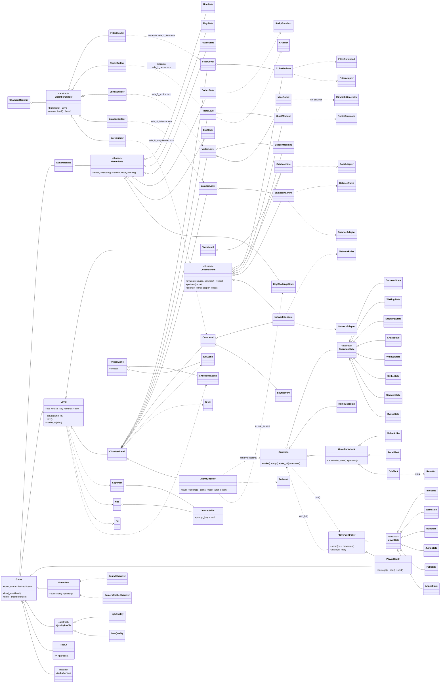

# Arquitectura (versión con escenas)

## Patrones de diseño (lo que pide la guía de la actividad)
| Tipo | Patrón | Dónde | Para qué |
|---|---|---|---|
| Creacional | **Factory Method** | `ChamberBuilder` → `FilterBuilder`, `RootsBuilder`, `VortexBuilder`, `BalanceBuilder`, `CoreBuilder`; `ChamberRegistry` | Cada creador instancia la escena de su sala según el `kind` de `chambers.json`. Para agregar una sala se crea una escena y un creador nuevos, sin tocar los demás. |
| Creacional | **Factory** | `AlarmDirector` (instancia `centinela.tscn`, `hechicero.tscn`, `runico.tscn`); `OrbShot` (instancia `orbe.tscn`) | Crea los guardianes de cada ola y los orbes del hechicero. |
| Estructural | **Facade** | `TileKit`, `AudioService` | Ocultan cómo se arman las partículas y el sonido con el pack de arte. |
| Estructural | **Adapter** | `DoorAdapter`, `FilterAdapter`, `BalanceAdapter`, `NetworkAdapter` | Pasan los objetos del juego al lenguaje del Códice (`puerta.abrir()`, `tolva.soltar()`, `plato_izq.poner(i)`, `red.vecinos(id)`). |
| Comportamiento | **State** | `StateMachine` + `GameState` (título, juego, pausa, Códice, reto de teclas…); `MoveState` (quieta, caminar, correr, saltar, golpear, caer); `GuardianState` (dormido, despertando, cayendo, persiguiendo, preparando, golpeando, aturdido, vencido) | Fases del juego, movimiento de Tala y comportamiento de los guardianes. |
| Comportamiento | **Observer** | `EventBus` + `SoundObserver`, `CameraShakeObserver`, `AlarmDirector` (escucha `MACHINE_FAILED`); `PlayerHealth` publica golpes y caídas; señales de los nodos (`used`, `crossed`, `fell`, `solved`, `defeated`) | El sonido, la cámara y la alarma reaccionan a los eventos sin que quien los emite sepa de ellos. |
| Comportamiento | **Strategy** | `QualityProfile` → `HighQuality`, `LowQuality`; `GuardianAttack` → `MeleeStrike` (caballero), `OrbShot` (hechicero), `RuneBlast` (rúnico) | Calidad de efectos; cómo ataca cada tipo de guardián. |
| Comportamiento | **Command** | `FilterCommand`, `RootsCommand` | El programa del jugador deja órdenes que la máquina ejecuta y anima una por una. |
| Comportamiento | **Template Method** | `CodeMachine` → `GateMachine`, `CribaMachine`, `MuralMachine`, `BeaconMachine`, `BalanceMachine`, `NetworkConsole` | Pasos fijos para correr el código. Cada máquina redefine `evaluate()` y `perform()`. |
| Comportamiento | **Interpreter** | `src/script_lang/` (Lexer, Parser, nodos, ScriptSandbox) | Ejecuta el código estilo Python que escribe el jugador. |

## SOLID y bajo acoplamiento
- **S**: cada script de escena hace una sola cosa. `Grate` abre y cierra una reja,
  `TriggerZone` avisa cuando se cruza, `FlickerLight` hace parpadear una luz y `Pit` es un foso.
- **O**: para agregar una sala se crea una escena nueva y un `ChamberBuilder` nuevo, y se
  registra. `Level` y `ChamberLevel` no cambian.
- **L**: todas las salas son `ChamberLevel` y el juego las trata igual. Todas las máquinas son
  `CodeMachine` y `CodexState` las usa igual.
- **I/D**: los niveles se comunican con nodos genéricos (`SignPost`, `Npc`, `CheckpointZone`,
  `ExitZone`, `Grate`) a través de señales, sin conocer sus detalles. El juego depende de
  `Level`, no de cada sala concreta.
- **Sin código rígido**: los textos, las rondas, los casos y los ritmos de las prensas están en
  `data/*.json`. Las posiciones están en las escenas (Inspector), no en constantes del código.

## Diagrama UML (clases principales)

