# Arquitectura (versión con escenas)

## Patrones de diseño (lo que pide la guía de la actividad)
| Tipo | Patrón | Dónde | Para qué |
|---|---|---|---|
| Creacional | **Factory Method** | `ChamberBuilder` → `FilterBuilder`, `RootsBuilder`, `VortexBuilder`, `FigureBuilder`, `CoreBuilder`, `ThroneBuilder`; `ChamberRegistry` | Cada creador instancia la escena de su sala según el `kind` de `chambers.json`. Para agregar una sala se crea una escena y un creador nuevos, sin tocar los demás. |
| Creacional | **Factory** | `AlarmDirector` (instancia `centinela.tscn`, `hechicero.tscn`, `runico.tscn`); `OrbShot` (instancia `orbe.tscn`) | Crea los guardianes de cada ola y los orbes del hechicero. |
| Estructural | **Facade** | `TileKit`, `AudioService` | Ocultan cómo se arman las partículas y el sonido con el pack de arte. |
| Estructural | **Facade** (SQL) | `SqlEngine` | El juego solo llama `run(consulta, tablas)`; por dentro pasan el lexer, el parser, la revisión de nombres, el JOIN, el WHERE, el ORDER BY y el LIMIT. |
| Comportamiento | **State** | `StateMachine` + `GameState` (título, juego, pausa, Códice, reto de teclas, rompecabezas de figuras…); `MoveState` (quieta, caminar, correr, saltar, golpear, caer); `GuardianState` (dormido, despertando, cayendo, persiguiendo, preparando, golpeando, aturdido, vencido); `BossState` (escondido, aparece, espera, persigue, ráfaga, pisotón, cansado, escudo, vencido) | Fases del juego, movimiento de Tala y comportamiento de los guardianes y del jefe. |
| Comportamiento | **Observer** | `EventBus` + `SoundObserver`, `CameraShakeObserver`, `AlarmDirector` (escucha `MACHINE_FAILED`); `PlayerHealth` publica golpes y caídas; señales de los nodos (`used`, `crossed`, `fell`, `solved`, `defeated`) | El sonido, la cámara y la alarma reaccionan a los eventos sin que quien los emite sepa de ellos. |
| Comportamiento | **Strategy** | `QualityProfile` → `HighQuality`, `LowQuality`; `GuardianAttack` → `MeleeStrike` (caballero), `OrbShot` (hechicero), `RuneBlast` (rúnico); `QuizProblem` → `OrderProblem`, `SqlProblem` → `KeywordProblem`, `SelectProblem`, `WhereProblem`, `SortProblem`, `JoinProblem` (con `BossQuiz` como contexto) | Calidad de efectos; cómo ataca cada tipo de guardián; qué problema pone el jefe en cada fase. |
| Comportamiento | **Command** | `FilterCommand` (armadas por `SphereSorter`) | Lo que trajo la consulta se vuelve órdenes (soltar esfera, mandarla al cáliz o al crisol) que la Criba anima una por una. |
| Comportamiento | **Template Method** | `CodeMachine` → `SqlMachine` → `GateMachine`, `LockMachine`, `BeaconMachine`, `BridgeMachine`, `GardenMachine`, `PumpMachine`, `CribaMachine`, `MillMachine`, `MuralMachine`, `BellsMachine`, `ScaleMachine`, `TwinsMachine`; `CodeMachine` → `TorchMachine`, `QueryMachine` (prácticas) | `SqlMachine.evaluate()` corre la consulta en cada ronda y la compara con la respuesta (`SqlCheck`); `perform()` la muestra. Cada máquina solo dice qué tablas inventa (`make_tables`), cómo reacciona (`react`) y cómo se dibuja. |
| Comportamiento | **Interpreter** | `src/sql_lang/` (`SqlLexer`, `SqlParser`, `SqlQuery`, `SqlEngine`) | Lee y corre las consultas SQL que escribe el jugador. |

## SOLID y bajo acoplamiento
- **S**: cada clase hace una sola cosa. `Grate` abre y cierra una reja, `TriggerZone` avisa
  cuando se cruza, `FlickerLight` hace parpadear una luz y `Pit` es un foso. `Game` solo
  compone y delega: los avisos son de `NoticeBoard`, el fundido de `ScreenFade` y las reglas
  de vidas y castigos de `LifeRules`. Las máquinas separan la lógica del dibujo
  (`CribaMachine` / `CribaView`; `RootsTrial`, `ParityFilter` y `FigurePuzzle` son reglas sin
  nada visible).
- **O**: para agregar una sala se crea una escena nueva y un `ChamberBuilder` nuevo, y se
  registra. `Level` y `ChamberLevel` no cambian. Lo mismo con un estado nuevo (de Tala, de un
  guardián o del jefe), un ataque nuevo o un tipo nuevo de problema del jefe: una clase nueva.
- **L**: todas las salas son `ChamberLevel` y el juego las trata igual. Todas las máquinas son
  `CodeMachine` y `CodexState` las usa igual. El pueblo y las salas son `Level`: `Game` llama a
  `save_state()` y `restart_after_death()` sin preguntar de qué tipo es (polimorfismo).
- **I/D**: los niveles se comunican con nodos genéricos (`SignPost`, `Npc`, `CheckpointZone`,
  `ExitZone`, `Grate`) a través de señales, sin conocer sus detalles. El juego depende de
  `Level`, no de cada sala concreta.
- **Encapsulamiento**: lo interno de cada clase empieza con `_` y ninguna otra clase lo toca;
  para eso hay métodos públicos (por ejemplo `TriggerZone.mark_fired()`).
- **Sin código rígido**: los textos que se leen en pantalla están en `data/texts.json`; las
  rondas, los casos, los ritmos de las prensas y los rangos de los problemas en
  `data/chambers.json`; la velocidad de Tala, el combate y los números de la pelea con el jefe
  en `data/config.json`. Las posiciones están en las escenas (Inspector).

**UML completo:** `docs/UML_COMPLETO.md` tiene las 175 clases, una por una, generado desde el
código con `python3 tools/generar_uml.py` (siempre coincide con el código). El diagrama de abajo
muestra las clases principales y cómo se relacionan.

## Diagrama UML (clases principales)

```mermaid
classDiagram
    direction LR
    class Game {
        +town_scene: PackedScene
        +load_level(level)
        +enter_chamber(index)
    }
    class StateMachine
    class GameState {
        <<abstract>>
        +enter() +update() +handle_input() +draw()
    }
    GameState <|-- TitleState
    GameState <|-- PlayState
    GameState <|-- PauseState
    GameState <|-- CodexState
    GameState <|-- EndState
    Game o-- StateMachine
    StateMachine o-- GameState

    class Level {
        +title +music_key +bounds +dark
        +setup(game, kit)
        +wire()
        +nodes_of(kind)
    }
    Level <|-- TownLevel
    Level <|-- ChamberLevel
    ChamberLevel <|-- FilterLevel
    ChamberLevel <|-- RootsLevel
    ChamberLevel <|-- VortexLevel
    ChamberLevel <|-- FigureLevel
    ChamberLevel <|-- CoreLevel
    ChamberLevel <|-- ThroneLevel
    Game --> Level

    class ChamberBuilder {
        <<abstract>>
        +build(data) Level
        +create_level()* Level
    }
    ChamberBuilder <|-- FilterBuilder
    ChamberBuilder <|-- RootsBuilder
    ChamberRegistry o-- ChamberBuilder
    FilterBuilder ..> FilterLevel : instancia sala_1_filtro.tscn
    RootsBuilder ..> RootsLevel : instancia sala_2_raices.tscn
    ChamberBuilder <|-- VortexBuilder
    ChamberBuilder <|-- FigureBuilder
    ChamberBuilder <|-- CoreBuilder
    ChamberBuilder <|-- ThroneBuilder
    VortexBuilder ..> VortexLevel : sala_3_vortice.tscn
    FigureBuilder ..> FigureLevel : sala_4_figuras.tscn
    CoreBuilder ..> CoreLevel : sala_5_singularidad.tscn
    ThroneBuilder ..> ThroneLevel : sala_6_trono.tscn

    class CodeMachine {
        <<abstract>>
        +evaluate(source, engine) Report
        +perform(report)
        +connect_console(open_codex)
    }
    class SqlMachine {
        <<abstract>>
        +answer +ordered +rounds
        +make_tables(round)* Array
        +react(right)
    }
    class SqlEngine {
        <<facade>>
        +run(source, tables) Result
    }
    SqlEngine ..> SqlLexer
    SqlEngine ..> SqlParser
    SqlParser ..> SqlQuery
    SqlEngine ..> SqlTable
    SqlMachine ..> SqlCheck
    CodeMachine <|-- SqlMachine
    SqlMachine <|-- GateMachine
    SqlMachine <|-- LockMachine
    SqlMachine <|-- BeaconMachine
    SqlMachine <|-- CribaMachine
    SqlMachine <|-- MuralMachine
    SqlMachine <|-- BridgeMachine
    SqlMachine <|-- GardenMachine
    SqlMachine <|-- PumpMachine
    SqlMachine <|-- MillMachine
    SqlMachine <|-- BellsMachine
    SqlMachine <|-- ScaleMachine
    SqlMachine <|-- TwinsMachine
    TownLevel o-- GateMachine
    FilterLevel o-- CribaMachine
    RootsLevel o-- MuralMachine
    VortexLevel o-- BeaconMachine
    CribaMachine ..> SphereSorter
    SphereSorter ..> FilterCommand
    CodexState ..> SqlEngine
    VortexLevel o-- MineBoard
    MineBoard ..> MinefieldGenerator : sin adivinar
    FigureLevel o-- FigureTable
    FigureTable o-- FigurePuzzle
    FigureLevel ..> PuzzleState : abre
    PuzzleState ..> FigurePuzzle
    CoreLevel o-- NumberPath
    ThroneLevel o-- ZeroBoss
    ZeroBoss ..> AlarmDirector : summon(ola)

    class TriggerZone { +crossed }
    TriggerZone <|-- CheckpointZone
    TriggerZone <|-- ExitZone
    class Interactable { +prompt_key +used }
    Level ..> SignPost
    Level ..> Npc
    Level ..> Pit
    Level ..> CheckpointZone
    ChamberLevel ..> ExitZone
    ChamberLevel ..> Grate
    RootsLevel ..> Crusher
    SignPost o-- Interactable
    Npc o-- Interactable

    class PlayerController {
        +setup(bus, movement)
        +place(at, face)
    }
    class MoveState { <<abstract>> }
    MoveState <|-- IdleState
    MoveState <|-- WalkState
    MoveState <|-- RunState
    MoveState <|-- JumpState
    MoveState <|-- FallState
    PlayerController o-- MoveState

    class AttackState
    MoveState <|-- AttackState
    class PlayerHealth { +damage() +heal() +refill() }
    PlayerController o-- PlayerHealth
    Game o-- PlayerHealth

    class AlarmDirector { +level +fighting() +calm() +reset_after_death() }
    ChamberLevel o-- AlarmDirector
    AlarmDirector ..> Guardian : crea y despierta
    AlarmDirector ..> Pedestal
    class Guardian { +wake() +drop() +take_hit() +restore() }
    class GuardianState { <<abstract>> }
    GuardianState <|-- DormantState
    GuardianState <|-- WakingState
    GuardianState <|-- DroppingState
    GuardianState <|-- ChaseState
    GuardianState <|-- WindupState
    GuardianState <|-- StrikeState
    GuardianState <|-- StaggerState
    GuardianState <|-- DyingState
    Guardian o-- GuardianState
    class ZeroBoss { +appear() +take_hit() +answered() +reset_for_retry() }
    class BossState { <<abstract>> +physics() +animation() +hittable() +draw() }
    BossState <|-- BossHiddenState
    BossState <|-- BossAppearState
    BossState <|-- BossWaitState
    BossState <|-- BossChaseState
    BossState <|-- BossVolleyState
    BossState <|-- BossSlamState
    BossState <|-- BossTiredState
    BossState <|-- BossShieldState
    BossState <|-- BossDyingState
    ZeroBoss o-- BossState
    BossVolleyState ..> RuneOrb : crea
    class GuardianAttack { <<strategy>> +windup_time() +perform() }
    GuardianAttack <|-- MeleeStrike
    GuardianAttack <|-- RuneBlast
    GuardianAttack <|-- OrbShot
    OrbShot ..> RuneOrb : crea
    Guardian <|-- RunicGuardian
    GameState <|-- KeyChallengeState
    AlarmDirector ..> KeyChallengeState : RUNE_BLAST
    Guardian o-- GuardianAttack
    Guardian ..> PlayerController : hurt()
    PlayerController ..> Guardian : take_hit()

    class EventBus { +subscribe() +publish() }
    EventBus <.. SoundObserver
    EventBus <.. CameraShakeObserver
    Game o-- EventBus

    class QualityProfile { <<abstract>> }
    QualityProfile <|-- HighQuality
    QualityProfile <|-- LowQuality
    Game o-- QualityProfile

    class TileKit { <<facade>> +particles() }
    class AudioService { <<facade>> }
    Game o-- TileKit
    Game o-- AudioService
    class NoticeBoard { +notify() +penalty() +tick() }
    class ScreenFade { +fade_in() +fade_out() +tick() }
    class LifeRules { +penalize() }
    Game o-- NoticeBoard
    Game o-- ScreenFade
    Game o-- LifeRules
    LifeRules ..> EventBus : PLAYER_DIED
    class BossQuiz { +make(kind, rng) }
    class QuizProblem { <<strategy>> +make(rng) }
    QuizProblem <|-- OrderProblem
    QuizProblem <|-- SqlProblem
    SqlProblem <|-- KeywordProblem
    SqlProblem <|-- SelectProblem
    SqlProblem <|-- WhereProblem
    SqlProblem <|-- SortProblem
    SqlProblem <|-- JoinProblem
    SqlProblem ..> SqlEngine
    BossQuiz o-- QuizProblem
    ThroneLevel o-- BossQuiz
    CribaMachine ..> CribaView : dibuja con
    CribaMachine o-- CribaSphere
    class MapExit { +target +entry }
    class Barrier { +need +crumble() }
    TriggerZone <|-- MapExit
    Level ..> MapExit : go_to_map
    Level ..> Barrier : abre según reached
```

## El mundo unido
`Game.load_map(id, entry)` carga uno de los 5 mapas de `chambers.json` ("maps") y pone a Tala en
el marcador `Entradas/<entry>`. Los `MapExit` de los bordes llaman a `go_to_map`. `Game.reached`
guarda hasta qué capítulo está abierto el mundo: cada `Barrier` se abre si `reached >= need`, y
`chapter_done()` sube `reached`, vuelve al mapa del capítulo y derrumba las rocas con la cámara
encima. La partida guarda `map`, `reached` y `chapter`.
