# UML completo (generado)

Generado por `tools/generar_uml.py` a partir del código: **190 clases**, un diagrama
por carpeta de `src/`. Las flechas `<|--` son herencia. Las relaciones entre paquetes
(composición, uso, eventos) están en el diagrama principal de `docs/ARQUITECTURA.md`.
Para actualizarlo: `python3 tools/generar_uml.py`.

## Raíz (Game)

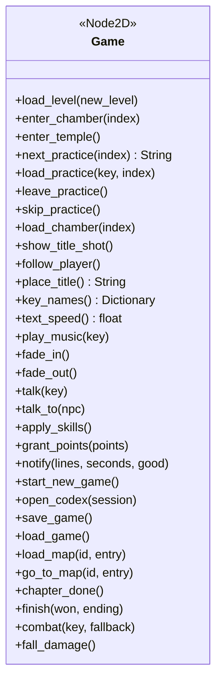

| Clase | Hereda de | Archivo |
|---|---|---|
| `Game` | `Node2D` | `src/game.gd` |

## `src/core/` — Servicios del juego (datos, eventos, reloj, vidas, guardado)

```mermaid
classDiagram
    class AudioService {
        <<Facade>>
        +play_sfx(sound)
        +play_music(track)
        +set_volume(bus_name, level)
    }
    class DataRepository {
        <<RefCounted>>
        +use_touch()
        +setting(key, fallback)
        +use_chapter(i)
        +use_order(ids)
        +room_id(room) String$
        +chapter_data(i) Dictionary
        +map_data(id) Dictionary
        +map_of_chapter(i) String
        +chapter_name(i) String
        +chamber_count() int
        +chamber_data(index) Dictionary
        +practice(key) Dictionary
        +talk(key) Array
        +message(key, params) String
        +messages(key) Array
    }
    class EventBus {
        <<Observer>>
        +subscribe(event, callback)
        +unsubscribe(event, callback)
        +publish(event, payload)
    }
    class GameEvents {
        <<RefCounted>>
    }
    class InputSetup {
        <<RefCounted>>
        +register(controls)$
        +key_name(action) String$
        +drop_mouse_bindings()$
    }
    class LifeRules {
        <<RefCounted>>
        +fall_damage()
    }
    class PlayerHealth {
        <<RefCounted>>
        +hearts() int
        +is_dead() bool
        +damage(amount) bool
        +heal(amount)
        +refill()
    }
    class QuestLog {
        <<RefCounted>>
        +quest(id) Dictionary
        +state(id) String
        +reset()
        +found_count(id) int
        +done_count() int
        +talk(id)
        +pick(item, id)
        +save_state() Dictionary
        +restore(data)
    }
    class SaveRepository {
        <<RefCounted>>
        +exists() bool
        +save(snapshot)
        +load_snapshot() Dictionary
        +clear()
    }
    class SecretCodeDetector {
        <<RefCounted>>
        +feed(unicode) bool
    }
    class SettingsRepository {
        <<RefCounted>>
        +get_int(key) int
        +get_bool(key) bool
        +set_value(key, value)
        +save()
        +apply()
    }
    class SkillTree {
        <<RefCounted>>
        +skill(id) Dictionary
        +level(id) int
        +max_level(id) int
        +free_points() int
        +can_raise(id) bool
        +raise(id) bool
        +grant(points)
        +reset()
        +save_state() Dictionary
        +restore(data)
    }
```

| Clase | Hereda de | Archivo |
|---|---|---|
| `AudioService` | `RefCounted` | `src/core/audio_service.gd` |
| `DataRepository` | `RefCounted` | `src/core/data_repository.gd` |
| `EventBus` | `RefCounted` | `src/core/event_bus.gd` |
| `GameEvents` | `RefCounted` | `src/core/game_events.gd` |
| `InputSetup` | `RefCounted` | `src/core/input_setup.gd` |
| `LifeRules` | `RefCounted` | `src/core/life_rules.gd` |
| `PlayerHealth` | `RefCounted` | `src/core/player_health.gd` |
| `QuestLog` | `RefCounted` | `src/core/quest_log.gd` |
| `SaveRepository` | `RefCounted` | `src/core/save_repository.gd` |
| `SecretCodeDetector` | `RefCounted` | `src/core/secret_code_detector.gd` |
| `SettingsRepository` | `RefCounted` | `src/core/settings_repository.gd` |
| `SkillTree` | `RefCounted` | `src/core/skill_tree.gd` |

## `src/player/` — Tala y sus estados (patrón State)

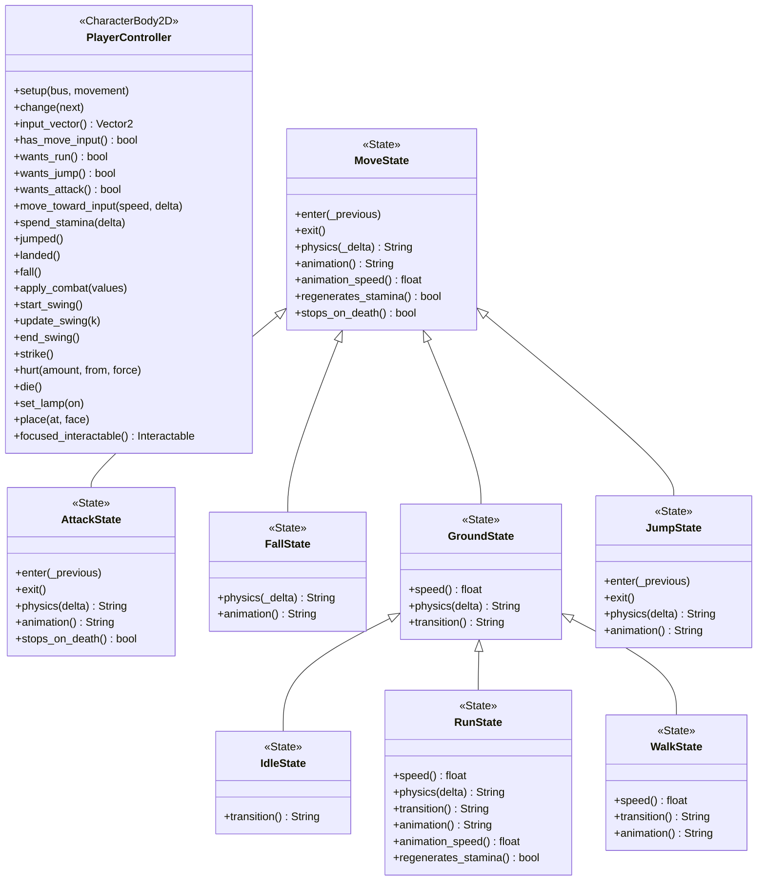

| Clase | Hereda de | Archivo |
|---|---|---|
| `PlayerController` | `CharacterBody2D` | `src/player/player_controller.gd` |
| `AttackState` | `MoveState` | `src/player/states/attack_state.gd` |
| `FallState` | `MoveState` | `src/player/states/fall_state.gd` |
| `GroundState` | `MoveState` | `src/player/states/ground_state.gd` |
| `IdleState` | `GroundState` | `src/player/states/idle_state.gd` |
| `JumpState` | `MoveState` | `src/player/states/jump_state.gd` |
| `MoveState` | `RefCounted` | `src/player/states/move_state.gd` |
| `RunState` | `GroundState` | `src/player/states/run_state.gd` |
| `WalkState` | `GroundState` | `src/player/states/walk_state.gd` |

## `src/enemies/` — Guardianes, jefe, sus estados (State) y ataques (Strategy)

```mermaid
classDiagram
    class GuardianAttack {
        <<Strategy>>
        +windup_time() float
        +cooldown() float
        +perform(_guardian, _player)
    }
    class MeleeStrike {
        <<Strategy>>
        +perform(guardian, player)
    }
    class OrbShot {
        <<Strategy>>
        +windup_time() float
        +cooldown() float
        +perform(guardian, player)
    }
    class RuneBlast {
        <<Strategy>>
        +windup_time() float
        +cooldown() float
        +perform(guardian, player)
    }
    class BossAppearState {
        <<State>>
        +enter()
        +physics(delta) String
        +animation() String
        +hittable() bool
    }
    class BossChaseState {
        <<State>>
        +physics(delta) String
        +animation() String
    }
    class BossDyingState {
        <<State>>
        +enter()
        +physics(delta) String
        +animation() String
        +hittable() bool
    }
    class BossHiddenState {
        <<State>>
        +enter()
        +hittable() bool
    }
    class BossShieldState {
        <<State>>
        +enter()
        +physics(delta) String
        +hittable() bool
    }
    class BossSlamState {
        <<State>>
        +enter()
        +physics(delta) String
        +draw()
    }
    class BossState {
        <<State>>
        +enter()
        +exit()
        +physics(_delta) String
        +animation() String
        +hittable() bool
        +draw()
    }
    class BossTiredState {
        <<State>>
        +physics(delta) String
        +animation() String
        +draw()
    }
    class BossVolleyState {
        <<State>>
        +enter()
        +physics(delta) String
        +animation() String
    }
    class BossWaitState {
        <<State>>
        +physics(delta) String
    }
    class Guardian {
        <<CharacterBody2D>>
        +is_ranged() bool
        +setup(p_bus, p_kit, p_settings)
        +change(next)
        +dir_name() String
        +wake()
        +drop(at)
        +restore()
        +dissolve()
        +is_active() bool
        +can_be_hit() bool
        +take_hit(amount, direction)
        +blow_up()
        +on_windup()
        +on_landed()
        +formation_target() Vector2
        +formation_slot() float
        +in_formation() bool
        +clear_shot(from) bool
        +blink() bool
        +player() PlayerController
        +to_player() Vector2
        +pace() float
        +setting(key, fallback)
        +burst(at, fx, amount, lifetime, gravity, 60)
        +separation() Vector2
    }
    class RuneOrb {
        <<Node2D>>
        +shatter()
    }
    class RunicGuardian {
        +on_windup()
        +on_landed()
        +explosion_fx()
    }
    class ChaseState {
        <<State>>
        +enter()
        +physics(delta) String
        +animation() String
        +hittable() bool
    }
    class DormantState {
        <<State>>
        +enter()
        +physics(delta) String
    }
    class DroppingState {
        <<State>>
        +enter()
        +exit()
        +physics(delta) String
        +animation() String
    }
    class DyingState {
        <<State>>
        +enter()
    }
    class GuardianState {
        <<State>>
        +enter()
        +exit()
        +physics(_delta) String
        +animation() String
        +hittable() bool
    }
    class StaggerState {
        <<State>>
        +enter()
        +exit()
        +physics(delta) String
        +animation() String
        +hittable() bool
    }
    class StrikeState {
        <<State>>
        +enter()
        +physics(delta) String
        +animation() String
        +hittable() bool
    }
    class WakingState {
        <<State>>
        +enter()
        +exit()
        +physics(delta) String
        +animation() String
    }
    class WindupState {
        <<State>>
        +enter()
        +exit()
        +physics(delta) String
        +hittable() bool
    }
    class ZeroBoss {
        <<CharacterBody2D>>
        +setup(p_bus, p_alarm, tuning)
        +change(next)
        +appear()
        +reset_for_retry()
        +answered(right)
        +is_awake() bool
        +phase_hp() int
        +can_be_hit() bool
        +take_hit(amount, direction)
        +publish(event)
        +player() PlayerController
        +return_home()
        +brake(delta)
        +anim_length(anim) float
    }
    GuardianAttack <|-- MeleeStrike
    GuardianAttack <|-- OrbShot
    GuardianAttack <|-- RuneBlast
    BossState <|-- BossAppearState
    BossState <|-- BossChaseState
    BossState <|-- BossDyingState
    BossState <|-- BossHiddenState
    BossState <|-- BossShieldState
    BossState <|-- BossSlamState
    BossState <|-- BossTiredState
    BossState <|-- BossVolleyState
    BossState <|-- BossWaitState
    Guardian <|-- RunicGuardian
    GuardianState <|-- ChaseState
    GuardianState <|-- DormantState
    GuardianState <|-- DroppingState
    GuardianState <|-- DyingState
    GuardianState <|-- StaggerState
    GuardianState <|-- StrikeState
    GuardianState <|-- WakingState
    GuardianState <|-- WindupState
```

| Clase | Hereda de | Archivo |
|---|---|---|
| `GuardianAttack` | `RefCounted` | `src/enemies/attacks/guardian_attack.gd` |
| `MeleeStrike` | `GuardianAttack` | `src/enemies/attacks/melee_strike.gd` |
| `OrbShot` | `GuardianAttack` | `src/enemies/attacks/orb_shot.gd` |
| `RuneBlast` | `GuardianAttack` | `src/enemies/attacks/rune_blast.gd` |
| `BossAppearState` | `BossState` | `src/enemies/boss_states/boss_appear_state.gd` |
| `BossChaseState` | `BossState` | `src/enemies/boss_states/boss_chase_state.gd` |
| `BossDyingState` | `BossState` | `src/enemies/boss_states/boss_dying_state.gd` |
| `BossHiddenState` | `BossState` | `src/enemies/boss_states/boss_hidden_state.gd` |
| `BossShieldState` | `BossState` | `src/enemies/boss_states/boss_shield_state.gd` |
| `BossSlamState` | `BossState` | `src/enemies/boss_states/boss_slam_state.gd` |
| `BossState` | `RefCounted` | `src/enemies/boss_states/boss_state.gd` |
| `BossTiredState` | `BossState` | `src/enemies/boss_states/boss_tired_state.gd` |
| `BossVolleyState` | `BossState` | `src/enemies/boss_states/boss_volley_state.gd` |
| `BossWaitState` | `BossState` | `src/enemies/boss_states/boss_wait_state.gd` |
| `Guardian` | `CharacterBody2D` | `src/enemies/guardian.gd` |
| `RuneOrb` | `Node2D` | `src/enemies/rune_orb.gd` |
| `RunicGuardian` | `Guardian` | `src/enemies/runic_guardian.gd` |
| `ChaseState` | `GuardianState` | `src/enemies/states/chase_state.gd` |
| `DormantState` | `GuardianState` | `src/enemies/states/dormant_state.gd` |
| `DroppingState` | `GuardianState` | `src/enemies/states/dropping_state.gd` |
| `DyingState` | `GuardianState` | `src/enemies/states/dying_state.gd` |
| `GuardianState` | `RefCounted` | `src/enemies/states/guardian_state.gd` |
| `StaggerState` | `GuardianState` | `src/enemies/states/stagger_state.gd` |
| `StrikeState` | `GuardianState` | `src/enemies/states/strike_state.gd` |
| `WakingState` | `GuardianState` | `src/enemies/states/waking_state.gd` |
| `WindupState` | `GuardianState` | `src/enemies/states/windup_state.gd` |
| `ZeroBoss` | `CharacterBody2D` | `src/enemies/zero_boss.gd` |

## `src/chambers/` — Salas, máquinas, fábricas (Factory Method), órdenes (Command) y problemas del jefe (Strategy)

```mermaid
classDiagram
    class AlarmDirector {
        <<Observer>>
        +setup(game, room)
        +enabled() bool
        +fighting() bool
        +alive_count() int
        +alive_by_kind() Dictionary
        +wave_size(n) int
        +runic_count(n) int
        +ranged_count(n) int
        +wave_kinds(n) Array
        +challenge(n) Dictionary
        +wave_speed(n) float
        +summon(n)
        +calm()
        +reset_after_death()
    }
    class BeaconMachine {
        +setup(bus, data, text, open_codex)
        +status_text() String
        +evaluate(source, sandbox) CodeMachine
        +perform(report)
    }
    class BellsMachine {
        +setup(bus, data, text, open_codex)
        +make_values() Array
        +api_for(song, record) Dictionary
        +summary(done) String
        +wanted(song) String
        +value_text(v) String
    }
    class BossQuiz {
        <<RefCounted>>
        +kinds() Array
        +make(kind, rng) Dictionary
    }
    class BridgeMachine {
        +setup(bus, data, text, open_codex)
        +make_values() Array
        +api_for(weight, record) Dictionary
        +wanted(weight) String
    }
    class ChamberBuilder {
        <<Factory Method>>
        +build(data) ChamberLevel
        +create_level() ChamberLevel
    }
    class ChamberLevel {
        +open_exit()
        +machine_blocked() bool
        +lock_machines(on)
        +room_entrance() Vector2
        +save_state() Dictionary
        +resume_from_save(state)
        +restore_solved()
        +restart_after_death()
    }
    class ChamberRegistry {
        <<RefCounted>>
        +register(kind, builder)$
        +create(data) ChamberLevel$
    }
    class CodeMachine {
        <<Template Method>>
        +evaluate(_source, _sandbox) Report
        +perform(_report)
        +status_text() String
        +view_center() Vector2
        +mark_solved()
        +show_code(source)
        +set_locked(on)
        +connect_console(open_codex)
    }
    class CoreBuilder {
        <<Factory Method>>
        +create_level() ChamberLevel
    }
    class CoreLevel {
        +wire()
        +rule_lines(key) Array
        +hud_line() String
        +player_fall()
    }
    class CribaMachine {
        <<Command>>
        +setup(kit, bus, data, text, open_codex)
        +new_rules()
        +evaluate(source, sandbox) CodeMachine
        +status_text() String
        +perform(report)
        +load_round(index, values)
        +drop_to_gate()
        +send_from_gate(to_chalice, right)
        +jam()
        +round_done(index)
    }
    class CribaSphere {
        <<Node2D>>
    }
    class CribaView {
        <<RefCounted>>
        +draw_board(ci, gate_open, round_lit, filled, time)$
    }
    class ExitZone {
    }
    class FigureBuilder {
        <<Factory Method>>
        +create_level() ChamberLevel
    }
    class FigureLevel {
        +wire()
        +restore_solved()
    }
    class FigurePuzzle {
        <<RefCounted>>
        +from_layout(layout, p_title, turned, rng) FigurePuzzle$
        +corner(cells) Vector2i$
        +normalized(cells) Array~Vector2i~$
        +extent(cells) Vector2i$
        +cells_of(i) Array~Vector2i~
        +rotate(i)
        +is_placed(i) bool
        +occupied(except) Dictionary
        +can_place(i, at) bool
        +place(i, at) bool
        +lift(i)
        +is_solved() bool
    }
    class FigureTable {
        <<Node2D>>
        +setup(data, rng, open_puzzle)
        +puzzle() FigurePuzzle
        +advance() bool
    }
    class FilterBuilder {
        <<Factory Method>>
        +create_level() ChamberLevel
    }
    class FilterCommand {
        <<Command>>
        +run(_machine)
    }
    class FilterLevel {
        +wire()
    }
    class FunctionRoundsMachine {
        +setup(bus, data, text, open_codex)
        +args_for(v) Array
        +shown(returned) String
        +after_run(result, sandbox, v, record) String
    }
    class GardenMachine {
        +setup(bus, data, text, open_codex)
        +make_values() Array
        +api_for(water, record) Dictionary
        +wanted(water) String
    }
    class GateMachine {
        +setup(data, text, open_fn, close_fn, open_codex)
        +evaluate(source, sandbox) CodeMachine
        +perform(report)
    }
    class LockBuilder {
        <<Factory Method>>
        +create_level() ChamberLevel
    }
    class LockLevel {
        +wire()
    }
    class LockMachine {
        +setup(bus, data, text, open_codex)
        +status_text() String
        +mark_solved()
        +evaluate(source, sandbox) CodeMachine
        +perform(report)
    }
    class MillMachine {
        +setup(bus, data, text, open_codex)
        +make_values() Array
        +wanted(sacks) String
    }
    class MineBoard {
        <<Node2D>>
        +cells() Array~Vector2i~
        +in_board(c) bool
        +cell_at(world) Vector2i
        +cell_center(c) Vector2
        +power_on()
        +reveal(c) Result
        +toggle_flag(c) bool
        +is_cleared() bool
        +reset()
        +show_solved()
        +neighbors(c) Array~Vector2i~
        +count_around(c) int
    }
    class MinefieldGenerator {
        <<RefCounted>>
        +generate(cells, mine_count, first) Dictionary
        +is_solvable(field, mines, first) bool
        +neighbors(field, cell) Array~Vector2i~
        +count_mines(field, mines, cell) int
    }
    class MuralMachine {
        <<Command>>
        +setup(kit, bus, data, text, open_codex)
        +new_trial()
        +status_text() String
        +evaluate(source, sandbox) CodeMachine
        +perform(report)
        +test_row(index, verdict, shown, _steps)
    }
    class NumberPath {
        <<Node2D>>
        +generate(rng, p_multiple, extra_safe, top)
        +in_grid(c) bool
        +is_safe(c) bool
        +origin() Vector2
        +cell_rect(c) Rect2
        +cell_center_global(c) Vector2
        +cell_at(world) Vector2i
        +over_void(world) bool
        +crumble(c)
    }
    class ParityFilter {
        <<RefCounted>>
        +make_round(rule, rng) Array$
        +is_even(value) bool$
        +start_round(index)
        +failed() bool
        +remaining() int
        +held() Variant
        +release() String
        +send(to_chalice) String
        +end_round()
    }
    class PumpMachine {
        +setup(bus, data, text, open_codex)
        +make_values() Array
        +api_for(start, record) Dictionary
        +summary(done) String
        +wanted(start) String
    }
    class ForProblem {
        <<Strategy>>
        +make(rng) Dictionary
    }
    class FuncProblem {
        <<Strategy>>
        +make(rng) Dictionary
    }
    class IfProblem {
        <<Strategy>>
        +make(rng) Dictionary
    }
    class ListProblem {
        <<Strategy>>
        +make(rng) Dictionary
    }
    class MultipleProblem {
        <<Strategy>>
        +make(rng) Dictionary
    }
    class OrderProblem {
        <<Strategy>>
        +make(rng) Dictionary
    }
    class ParityProblem {
        <<Strategy>>
        +make(rng) Dictionary
    }
    class QuizProblem {
        <<Strategy>>
        +make(_rng) Dictionary
        +say(key, params) String
        +pick(right, wrong, count) Dictionary$
    }
    class SolveProblem {
        <<Strategy>>
        +make(rng) Dictionary
    }
    class VariableProblem {
        <<Strategy>>
        +make(rng) Dictionary
        +program(rng, lines, start_max) Dictionary$
    }
    class WhileProblem {
        <<Strategy>>
        +make(rng) Dictionary
    }
    class RootsBuilder {
        <<Factory Method>>
        +create_level() ChamberLevel
    }
    class RootsCommand {
        <<Command>>
        +run(machine)
    }
    class RootsLevel {
        +wire()
    }
    class RootsTrial {
        <<RefCounted>>
        +make_case(kind, rng) Dictionary$
        +equation(a, b, c) String$
        +answer(value) String$
        +judge(case, value) Verdict$
    }
    class RoundsLevel {
        +wire()
    }
    class RoundsMachine {
        <<Template Method>>
        +setup(bus, data, text, open_codex)
        +status_text() String
        +make_values() Array
        +api_for(_value, _record) Dictionary
        +wanted(_value) String
        +summary(done) String
        +after_run(_result, _sandbox, _value, _record) String
        +value_text(v) String
        +evaluate(source, sandbox) CodeMachine
        +perform(report)
        +mark_solved()
    }
    class ScaleMachine {
        +make_values() Array
        +api_for(weights, record) Dictionary
        +wanted(weights) String
        +value_text(v) String
    }
    class SceneBuilder {
        <<Factory Method>>
        +create_level() ChamberLevel
    }
    class ThroneBuilder {
        <<Factory Method>>
        +create_level() ChamberLevel
    }
    class ThroneLevel {
        +wire()
        +restart_after_death()
    }
    class TwinsMachine {
        +make_values() Array
        +args_for(v) Array
        +shown(returned) String
        +wanted(v) String
        +value_text(v) String
        +polynomial(b, c) String$
    }
    class VortexBuilder {
        <<Factory Method>>
        +create_level() ChamberLevel
    }
    class VortexLevel {
        +wire()
        +handle_action(actions) bool
        +action_prompt() Dictionary
        +hud_line() String
        +restore_solved()
        +restart_after_death()
        +touch_actions() Array
    }
    CodeMachine <|-- BeaconMachine
    RoundsMachine <|-- BellsMachine
    RoundsMachine <|-- BridgeMachine
    Level <|-- ChamberLevel
    ChamberBuilder <|-- CoreBuilder
    ChamberLevel <|-- CoreLevel
    CodeMachine <|-- CribaMachine
    TriggerZone <|-- ExitZone
    ChamberBuilder <|-- FigureBuilder
    ChamberLevel <|-- FigureLevel
    ChamberBuilder <|-- FilterBuilder
    ChamberLevel <|-- FilterLevel
    RoundsMachine <|-- FunctionRoundsMachine
    RoundsMachine <|-- GardenMachine
    CodeMachine <|-- GateMachine
    ChamberBuilder <|-- LockBuilder
    ChamberLevel <|-- LockLevel
    CodeMachine <|-- LockMachine
    FunctionRoundsMachine <|-- MillMachine
    CodeMachine <|-- MuralMachine
    RoundsMachine <|-- PumpMachine
    QuizProblem <|-- ForProblem
    QuizProblem <|-- FuncProblem
    QuizProblem <|-- IfProblem
    QuizProblem <|-- ListProblem
    QuizProblem <|-- MultipleProblem
    QuizProblem <|-- OrderProblem
    QuizProblem <|-- ParityProblem
    QuizProblem <|-- SolveProblem
    QuizProblem <|-- VariableProblem
    QuizProblem <|-- WhileProblem
    ChamberBuilder <|-- RootsBuilder
    ChamberLevel <|-- RootsLevel
    ChamberLevel <|-- RoundsLevel
    CodeMachine <|-- RoundsMachine
    RoundsMachine <|-- ScaleMachine
    ChamberBuilder <|-- SceneBuilder
    ChamberBuilder <|-- ThroneBuilder
    ChamberLevel <|-- ThroneLevel
    FunctionRoundsMachine <|-- TwinsMachine
    ChamberBuilder <|-- VortexBuilder
    ChamberLevel <|-- VortexLevel
```

| Clase | Hereda de | Archivo |
|---|---|---|
| `AlarmDirector` | `Node` | `src/chambers/alarm_director.gd` |
| `BeaconMachine` | `CodeMachine` | `src/chambers/beacon_machine.gd` |
| `BellsMachine` | `RoundsMachine` | `src/chambers/bells_machine.gd` |
| `BossQuiz` | `RefCounted` | `src/chambers/boss_quiz.gd` |
| `BridgeMachine` | `RoundsMachine` | `src/chambers/bridge_machine.gd` |
| `ChamberBuilder` | `RefCounted` | `src/chambers/chamber_builder.gd` |
| `ChamberLevel` | `Level` | `src/chambers/chamber_level.gd` |
| `ChamberRegistry` | `RefCounted` | `src/chambers/chamber_registry.gd` |
| `CodeMachine` | `Node2D` | `src/chambers/code_machine.gd` |
| `CoreBuilder` | `ChamberBuilder` | `src/chambers/core_builder.gd` |
| `CoreLevel` | `ChamberLevel` | `src/chambers/core_level.gd` |
| `CribaMachine` | `CodeMachine` | `src/chambers/criba_machine.gd` |
| `CribaSphere` | `Node2D` | `src/chambers/criba_sphere.gd` |
| `CribaView` | `RefCounted` | `src/chambers/criba_view.gd` |
| `ExitZone` | `TriggerZone` | `src/chambers/exit_zone.gd` |
| `FigureBuilder` | `ChamberBuilder` | `src/chambers/figure_builder.gd` |
| `FigureLevel` | `ChamberLevel` | `src/chambers/figure_level.gd` |
| `FigurePuzzle` | `RefCounted` | `src/chambers/figure_puzzle.gd` |
| `FigureTable` | `Node2D` | `src/chambers/figure_table.gd` |
| `FilterBuilder` | `ChamberBuilder` | `src/chambers/filter_builder.gd` |
| `FilterCommand` | `RefCounted` | `src/chambers/filter_command.gd` |
| `FilterLevel` | `ChamberLevel` | `src/chambers/filter_level.gd` |
| `FunctionRoundsMachine` | `RoundsMachine` | `src/chambers/function_rounds_machine.gd` |
| `GardenMachine` | `RoundsMachine` | `src/chambers/garden_machine.gd` |
| `GateMachine` | `CodeMachine` | `src/chambers/gate_machine.gd` |
| `LockBuilder` | `ChamberBuilder` | `src/chambers/lock_builder.gd` |
| `LockLevel` | `ChamberLevel` | `src/chambers/lock_level.gd` |
| `LockMachine` | `CodeMachine` | `src/chambers/lock_machine.gd` |
| `MillMachine` | `FunctionRoundsMachine` | `src/chambers/mill_machine.gd` |
| `MineBoard` | `Node2D` | `src/chambers/mine_board.gd` |
| `MinefieldGenerator` | `RefCounted` | `src/chambers/minefield_generator.gd` |
| `MuralMachine` | `CodeMachine` | `src/chambers/mural_machine.gd` |
| `NumberPath` | `Node2D` | `src/chambers/number_path.gd` |
| `ParityFilter` | `RefCounted` | `src/chambers/parity_filter.gd` |
| `PumpMachine` | `RoundsMachine` | `src/chambers/pump_machine.gd` |
| `ForProblem` | `QuizProblem` | `src/chambers/quiz/for_problem.gd` |
| `FuncProblem` | `QuizProblem` | `src/chambers/quiz/func_problem.gd` |
| `IfProblem` | `QuizProblem` | `src/chambers/quiz/if_problem.gd` |
| `ListProblem` | `QuizProblem` | `src/chambers/quiz/list_problem.gd` |
| `MultipleProblem` | `QuizProblem` | `src/chambers/quiz/multiple_problem.gd` |
| `OrderProblem` | `QuizProblem` | `src/chambers/quiz/order_problem.gd` |
| `ParityProblem` | `QuizProblem` | `src/chambers/quiz/parity_problem.gd` |
| `QuizProblem` | `RefCounted` | `src/chambers/quiz/quiz_problem.gd` |
| `SolveProblem` | `QuizProblem` | `src/chambers/quiz/solve_problem.gd` |
| `VariableProblem` | `QuizProblem` | `src/chambers/quiz/variable_problem.gd` |
| `WhileProblem` | `QuizProblem` | `src/chambers/quiz/while_problem.gd` |
| `RootsBuilder` | `ChamberBuilder` | `src/chambers/roots_builder.gd` |
| `RootsCommand` | `RefCounted` | `src/chambers/roots_command.gd` |
| `RootsLevel` | `ChamberLevel` | `src/chambers/roots_level.gd` |
| `RootsTrial` | `RefCounted` | `src/chambers/roots_trial.gd` |
| `RoundsLevel` | `ChamberLevel` | `src/chambers/rounds_level.gd` |
| `RoundsMachine` | `CodeMachine` | `src/chambers/rounds_machine.gd` |
| `ScaleMachine` | `RoundsMachine` | `src/chambers/scale_machine.gd` |
| `SceneBuilder` | `ChamberBuilder` | `src/chambers/scene_builder.gd` |
| `ThroneBuilder` | `ChamberBuilder` | `src/chambers/throne_builder.gd` |
| `ThroneLevel` | `ChamberLevel` | `src/chambers/throne_level.gd` |
| `TwinsMachine` | `FunctionRoundsMachine` | `src/chambers/twins_machine.gd` |
| `VortexBuilder` | `ChamberBuilder` | `src/chambers/vortex_builder.gd` |
| `VortexLevel` | `ChamberLevel` | `src/chambers/vortex_level.gd` |

## `src/script_lang/` — El lenguaje del Códice (Interpreter, Composite, Adapter, Facade)

```mermaid
classDiagram
    class CallsAdapter {
        <<Adapter>>
        +type_name() String
        +get_method(attr) ScriptCallable
    }
    class DoorAdapter {
        <<Adapter>>
        +type_name() String
        +get_method(attr) ScriptCallable
        +get_attribute(ctx, attr, line)
    }
    class FilterAdapter {
        <<Adapter>>
        +objects(rules, text) Dictionary$
    }
    class LightsAdapter {
        <<Adapter>>
        +type_name() String
        +get_method(attr) ScriptCallable
        +get_attribute(ctx, attr, line)
    }
    class LockAdapter {
        <<Adapter>>
        +type_name() String
        +get_method(attr) ScriptCallable
    }
    class SensorAdapter {
        <<Adapter>>
        +type_name() String
        +get_method(attr) ScriptCallable
    }
    class TorchAdapter {
        <<Adapter>>
        +type_name() String
        +get_method(attr) ScriptCallable
    }
    class HostFunction {
        +invoke(ctx, args, line)
    }
    class Lexer {
        <<RefCounted>>
        +tokenize(source) Array
    }
    class Parser {
        <<RefCounted>>
        +parse(tokens) ScriptNode
    }
    class ScriptCallable {
        <<RefCounted>>
        +invoke(_ctx, _args, _line) Variant
    }
    class ScriptContext {
        <<RefCounted>>
        +failed() bool
        +fail(message, line)
        +tick(line) bool
        +push_frame(locals) bool
        +pop_frame()
        +has_name(name) bool
        +lookup(name, line)
        +assign(name, value)
        +print_line(text)
        +suggest(name) String
        +truthy(v) bool$
        +to_text(v) String$
        +repr(v) String$
        +type_name(v) String$
        +is_number(v) bool$
        +py_mod(a, b)$
        +py_floordiv(a, b)$
    }
    class ScriptMessages {
        <<RefCounted>>
        +text(key) String$
    }
    class ScriptNode {
        <<Interpreter>>
        +evaluate(_ctx) Variant
        +execute(ctx)
    }
    class ScriptNodes {
        <<Interpreter y Composite>>
        +apply_binary(op, a, b, ctx, line)$
        +compare(op, a, b, ctx, line) bool$
    }
    class ScriptObject {
        <<Adapter>>
        +type_name() String
        +describe() String
        +get_attribute(ctx, attr, line) Variant
        +set_attribute(ctx, attr, _value, line)
        +get_method(_attr) ScriptCallable
        +get_index(ctx, _index, line) Variant
        +help() Array
    }
    class ScriptSandbox {
        <<Facade>>
        +run(source, api, max_steps) Result
        +call_function(result, function_name, args) Array
    }
    ScriptObject <|-- CallsAdapter
    ScriptObject <|-- DoorAdapter
    ScriptObject <|-- LightsAdapter
    ScriptObject <|-- LockAdapter
    ScriptObject <|-- SensorAdapter
    ScriptObject <|-- TorchAdapter
    ScriptCallable <|-- HostFunction
```

| Clase | Hereda de | Archivo |
|---|---|---|
| `CallsAdapter` | `ScriptObject` | `src/script_lang/adapters/calls_adapter.gd` |
| `DoorAdapter` | `ScriptObject` | `src/script_lang/adapters/door_adapter.gd` |
| `FilterAdapter` | `RefCounted` | `src/script_lang/adapters/filter_adapter.gd` |
| `LightsAdapter` | `ScriptObject` | `src/script_lang/adapters/lights_adapter.gd` |
| `LockAdapter` | `ScriptObject` | `src/script_lang/adapters/lock_adapter.gd` |
| `SensorAdapter` | `ScriptObject` | `src/script_lang/adapters/sensor_adapter.gd` |
| `TorchAdapter` | `ScriptObject` | `src/script_lang/adapters/torch_adapter.gd` |
| `HostFunction` | `ScriptCallable` | `src/script_lang/host_function.gd` |
| `Lexer` | `RefCounted` | `src/script_lang/lexer.gd` |
| `Parser` | `RefCounted` | `src/script_lang/parser.gd` |
| `ScriptCallable` | `RefCounted` | `src/script_lang/script_callable.gd` |
| `ScriptContext` | `RefCounted` | `src/script_lang/script_context.gd` |
| `ScriptMessages` | `RefCounted` | `src/script_lang/script_messages.gd` |
| `ScriptNode` | `RefCounted` | `src/script_lang/script_node.gd` |
| `ScriptNodes` | `RefCounted` | `src/script_lang/script_nodes.gd` |
| `ScriptObject` | `RefCounted` | `src/script_lang/script_object.gd` |
| `ScriptSandbox` | `RefCounted` | `src/script_lang/script_sandbox.gd` |

## `src/states/` — Pantallas del juego (patrón State)

```mermaid
classDiagram
    class BookState {
        <<State>>
        +enter(params)
        +freezes_world() bool
        +touch_buttons() Array
        +handle_input(actions)
        +draw(ui)
    }
    class CodexState {
        <<State>>
        +enter(params)
        +exit()
        +touch_buttons() Array
        +handle_input(actions)
        +run()
        +draw(ui)
    }
    class CreditsState {
        <<State>>
        +touch_tap() String
        +handle_input(actions)
        +draw(ui)
    }
    class EndState {
        <<State>>
        +enter(params)
        +touch_tap() String
        +handle_input(actions)
        +update(delta)
        +draw(ui)
    }
    class GameState {
        <<State>>
        +enter(_params)
        +exit()
        +handle_input(_actions)
        +handle_key(_event) bool
        +handle_mouse(_event) bool
        +update(_delta)
        +draw(_ui)
        +freezes_world() bool
        +touch_buttons() Array
        +touch_tap() String
        +touch_stick() bool
        +touch_keys() Array
    }
    class IntroState {
        <<State>>
        +enter(_params)
        +touch_tap() String
        +touch_buttons() Array
        +handle_input(actions)
        +update(delta)
        +draw(ui)
    }
    class KeyChallengeState {
        <<State>>
        +random_keys(pool, count) Array$
        +enter(params)
        +exit()
        +touch_keys() Array
        +handle_key(event) bool
        +is_getting_ready() bool
        +time_left() float
        +update(_delta)
        +draw(ui)
    }
    class MenuState {
        <<State>>
        +enter(_params)
        +handle_mouse(event) bool
        +handle_input(actions)
        +draw(ui)
    }
    class PauseState {
        <<State>>
        +enter(params)
        +freezes_world() bool
        +handle_mouse(event) bool
        +handle_input(actions)
        +update(delta)
        +draw(ui)
    }
    class PlayState {
        <<State>>
        +enter(params)
        +exit()
        +touch_stick() bool
        +touch_tap() String
        +touch_buttons() Array
        +handle_input(actions)
        +update(delta)
        +draw(ui)
    }
    class PuzzleState {
        <<State>>
        +enter(params)
        +exit()
        +freezes_world() bool
        +handle_mouse(event) bool
        +touch_buttons() Array
        +handle_input(actions)
        +check_solved(ui)
        +update(_delta)
        +draw(ui)
    }
    class QuizState {
        <<State>>
        +enter(params)
        +freezes_world() bool
        +handle_key(event) bool
        +handle_mouse(event) bool
        +choose(i)
        +right() bool
        +update(delta)
        +draw(ui)
    }
    class SettingsState {
        <<State>>
        +enter(params)
        +freezes_world() bool
        +touch_buttons() Array
        +handle_mouse(event) bool
        +handle_input(actions)
        +draw(ui)
    }
    class SkillsState {
        <<State>>
        +enter(_params)
        +freezes_world() bool
        +touch_buttons() Array
        +handle_mouse(event) bool
        +handle_input(actions)
        +draw(ui)
    }
    class StateMachine {
        <<State>>
        +add(state_name, state)
        +get_state(state_name) GameState
        +change(state_name, params)
    }
    class TitleState {
        <<State>>
        +enter(_params)
        +touch_tap() String
        +handle_input(actions)
        +draw(ui)
    }
    GameState <|-- BookState
    GameState <|-- CodexState
    GameState <|-- CreditsState
    GameState <|-- EndState
    GameState <|-- IntroState
    GameState <|-- KeyChallengeState
    GameState <|-- MenuState
    GameState <|-- PauseState
    GameState <|-- PlayState
    GameState <|-- PuzzleState
    GameState <|-- QuizState
    GameState <|-- SettingsState
    GameState <|-- SkillsState
    GameState <|-- TitleState
```

| Clase | Hereda de | Archivo |
|---|---|---|
| `BookState` | `GameState` | `src/states/book_state.gd` |
| `CodexState` | `GameState` | `src/states/codex_state.gd` |
| `CreditsState` | `GameState` | `src/states/credits_state.gd` |
| `EndState` | `GameState` | `src/states/end_state.gd` |
| `GameState` | `RefCounted` | `src/states/game_state.gd` |
| `IntroState` | `GameState` | `src/states/intro_state.gd` |
| `KeyChallengeState` | `GameState` | `src/states/key_challenge_state.gd` |
| `MenuState` | `GameState` | `src/states/menu_state.gd` |
| `PauseState` | `GameState` | `src/states/pause_state.gd` |
| `PlayState` | `GameState` | `src/states/play_state.gd` |
| `PuzzleState` | `GameState` | `src/states/puzzle_state.gd` |
| `QuizState` | `GameState` | `src/states/quiz_state.gd` |
| `SettingsState` | `GameState` | `src/states/settings_state.gd` |
| `SkillsState` | `GameState` | `src/states/skills_state.gd` |
| `StateMachine` | `RefCounted` | `src/states/state_machine.gd` |
| `TitleState` | `GameState` | `src/states/title_state.gd` |

## `src/ui/` — Interfaz

```mermaid
classDiagram
    class BlockBoard {
        <<Control>>
        +font_size() int
        +program_rect() Rect2
        +tray_rect() Rect2
        +row_height() float
        +piece_size(piece) Vector2
        +row_rect(row) Rect2
        +tray_layout() Dictionary
        +row_at(point) int
        +tray_piece_at(point) int
        +drop_target() Vector2i
        +max_indent(row) int
        +place(piece, row, indent)
        +take_back(row)
        +shift(row, delta)
        +move(row, delta)
        +suggested_indent(row) int
    }
    class CodexPanel {
        <<Control>>
        +fold(folded)
        +open(session, keys_text, side)
        +close() String
        +source() String
        +write(code)
        +toggle_mode()
        +show_mode()
        +log_line(text, color)
    }
    class CodexSession {
        <<RefCounted>>
        +count_lines(source) int$
        +set_blocks(lines)
        +free_pieces() Array
        +blocks_source() String
        +blocks_state() Dictionary
        +restore_blocks(state)
    }
    class DialogBox {
        <<RefCounted>>
        +is_open() bool
        +say(texts, on_done)
        +close()
        +update(delta, chars_per_second)
        +advance()
        +draw(ui)
    }
    class Hud {
        <<RefCounted>>
        +draw(ui, info)
        +draw_notice(ui, text, left, good, top, place)
        +draw_hearts(ui, health, hurt)
        +draw_alarm(ui, level, guardians, label)
    }
    class MenuList {
        <<RefCounted>>
        +move(actions) bool
        +is_enabled(i) bool
        +first_enabled()
        +selected() String
        +height() float
        +index_at(point) int
        +clicked(event, point) bool
        +draw(ui, at, width)
    }
    class NoticeBoard {
        <<RefCounted>>
        +notify(lines, seconds, is_good, is_place)
        +tick(delta)
    }
    class OverlayCanvas {
        <<Control>>
    }
    class ScreenFade {
        <<RefCounted>>
        +fade_in()
        +fade_out()
        +tick(delta)
    }
    class TouchControls {
        <<Control>>
        +setup(p_game, p_names, mouse_as_finger)
    }
    class UIKit {
        <<RefCounted>>
        +size() Vector2
        +font(name) Font
        +rect(r, color)
        +frame(r, color, width)
        +line(a, b, color, width)
        +diamond(center, half, color)
        +arc(center, radius, from, to, color, width)
        +panel(r, fill)
        +pill(r, fill, border)
        +text(s, at, font_size, color, font_name, shadow)
        +text_centered(s, y, font_size, color, font_name, center_x)
        +text_right(s, right_x, y, font_size, color, font_name)
        +measure(s, font_size, font_name) float
        +line_height(font_size, font_name) float
        +wrap(s, max_width, font_size, font_name) Array
        +key_hint(key, label_text, at, font_size) float
        +cursor(at, color)
        +more_arrow(at)
        +blink(rate) bool
        +dim(amount)
        +bar(at, level, maximum, color)
        +texture_region(texture, dest, source, modulate)
        +vignette(strength, color)
    }
```

| Clase | Hereda de | Archivo |
|---|---|---|
| `BlockBoard` | `Control` | `src/ui/block_board.gd` |
| `CodexPanel` | `Control` | `src/ui/codex_panel.gd` |
| `CodexSession` | `RefCounted` | `src/ui/codex_session.gd` |
| `DialogBox` | `RefCounted` | `src/ui/dialog_box.gd` |
| `Hud` | `RefCounted` | `src/ui/hud.gd` |
| `MenuList` | `RefCounted` | `src/ui/menu_list.gd` |
| `NoticeBoard` | `RefCounted` | `src/ui/notice_board.gd` |
| `OverlayCanvas` | `Control` | `src/ui/overlay_canvas.gd` |
| `ScreenFade` | `RefCounted` | `src/ui/screen_fade.gd` |
| `TouchControls` | `Control` | `src/ui/touch_controls.gd` |
| `UIKit` | `RefCounted` | `src/ui/ui_kit.gd` |

## `src/world/` — Piezas de los mapas

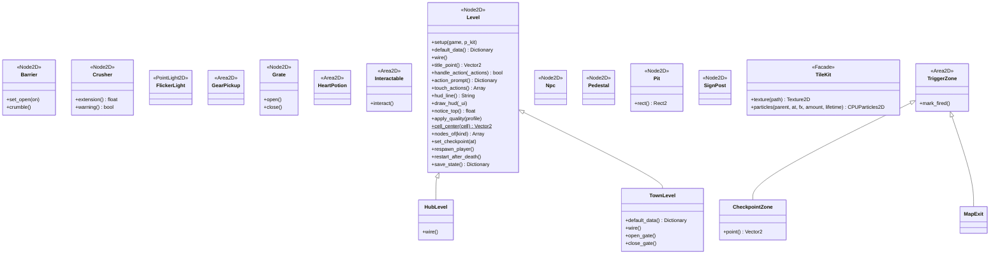

| Clase | Hereda de | Archivo |
|---|---|---|
| `Barrier` | `Node2D` | `src/world/barrier.gd` |
| `CheckpointZone` | `TriggerZone` | `src/world/checkpoint_zone.gd` |
| `Crusher` | `Node2D` | `src/world/crusher.gd` |
| `FlickerLight` | `PointLight2D` | `src/world/flicker_light.gd` |
| `GearPickup` | `Area2D` | `src/world/gear_pickup.gd` |
| `Grate` | `Node2D` | `src/world/grate.gd` |
| `HeartPotion` | `Area2D` | `src/world/heart_potion.gd` |
| `HubLevel` | `Level` | `src/world/hub_level.gd` |
| `Interactable` | `Area2D` | `src/world/interactable.gd` |
| `Level` | `Node2D` | `src/world/level.gd` |
| `MapExit` | `TriggerZone` | `src/world/map_exit.gd` |
| `Npc` | `Node2D` | `src/world/npc.gd` |
| `Pedestal` | `Node2D` | `src/world/pedestal.gd` |
| `Pit` | `Node2D` | `src/world/pit.gd` |
| `SignPost` | `Node2D` | `src/world/sign_post.gd` |
| `TileKit` | `RefCounted` | `src/world/tile_kit.gd` |
| `TownLevel` | `Level` | `src/world/town_level.gd` |
| `TriggerZone` | `Area2D` | `src/world/trigger_zone.gd` |

## `src/observers/` — Observadores (patrón Observer)

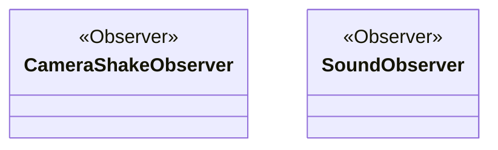

| Clase | Hereda de | Archivo |
|---|---|---|
| `CameraShakeObserver` | `RefCounted` | `src/observers/camera_shake_observer.gd` |
| `SoundObserver` | `RefCounted` | `src/observers/sound_observer.gd` |

## `src/quality/` — Calidad de efectos (patrón Strategy)

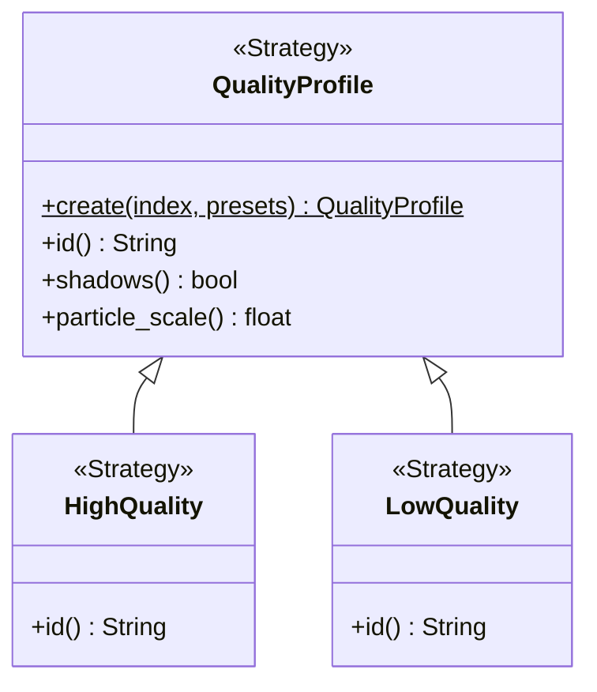

| Clase | Hereda de | Archivo |
|---|---|---|
| `HighQuality` | `QualityProfile` | `src/quality/high_quality.gd` |
| `LowQuality` | `QualityProfile` | `src/quality/low_quality.gd` |
| `QualityProfile` | `RefCounted` | `src/quality/quality_profile.gd` |

## `src/camera/` — Cámara

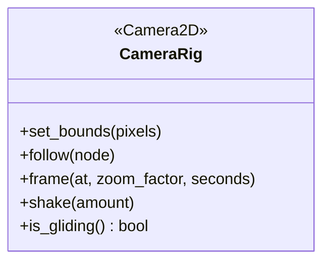

| Clase | Hereda de | Archivo |
|---|---|---|
| `CameraRig` | `Camera2D` | `src/camera/camera_rig.gd` |

## `src/fx/` — Efectos

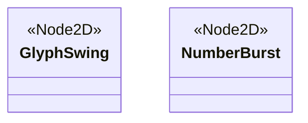

| Clase | Hereda de | Archivo |
|---|---|---|
| `GlyphSwing` | `Node2D` | `src/fx/glyph_swing.gd` |
| `NumberBurst` | `Node2D` | `src/fx/number_burst.gd` |

## `src/tests/` — Pruebas automáticas

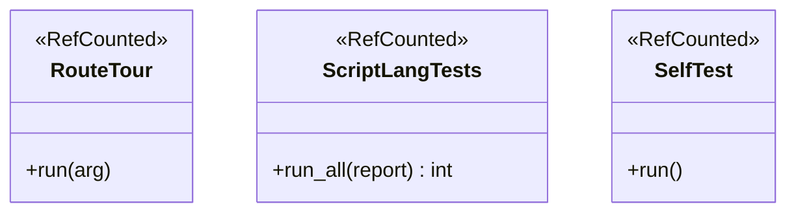

| Clase | Hereda de | Archivo |
|---|---|---|
| `RouteTour` | `RefCounted` | `src/tests/route_tour.gd` |
| `ScriptLangTests` | `RefCounted` | `src/tests/script_lang_tests.gd` |
| `SelfTest` | `RefCounted` | `src/tests/self_test.gd` |
